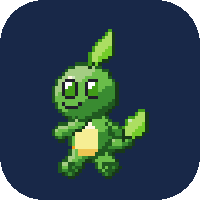
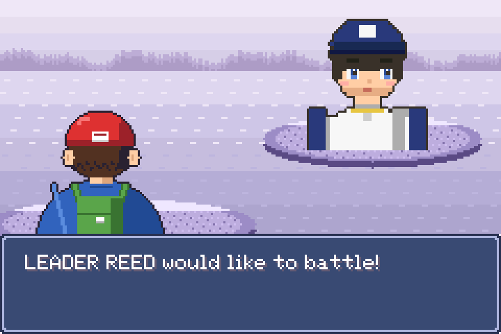
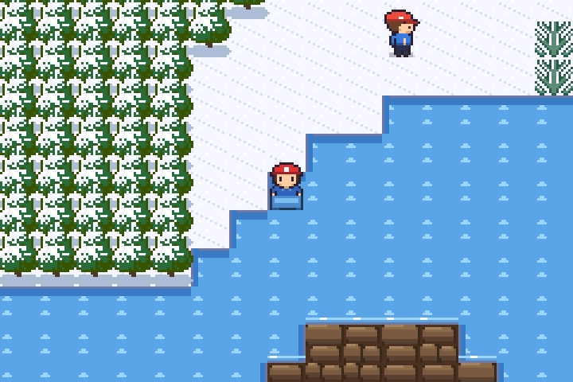
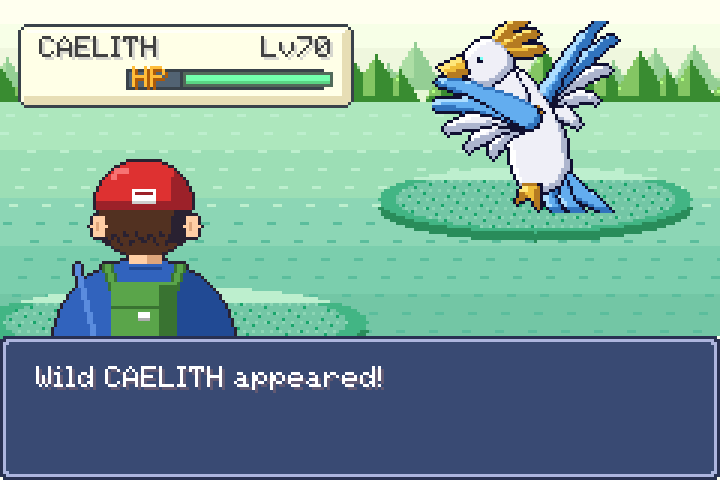
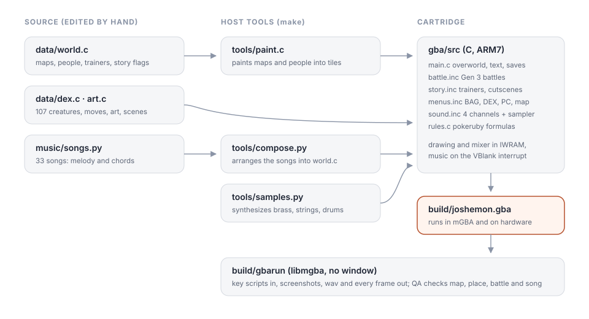

  

A whole adventure on one tiny cartridge.

Joshémon is a monster-collecting RPG for the Game Boy Advance, written in C. The 105 creatures, the region, the story and every song are our own. It plays like the 2003 handheld games did. **[joshemon.jaybulb.com](https://joshemon.jaybulb.com)**

## Get it

Download `joshemon.gba` from the [latest release](https://github.com/nulljosh/joshemon/releases/latest) or the site. Open it in [mGBA](https://mgba.io), or copy it to a flash cart and play it on a real GBA. Your game saves to the cartridge.

## Features
- 105 original creatures, plus three legends that sleep somewhere in the world.
- Eight gyms, a rival, a villain team, VICTORY ROAD, the ELITE FOUR, a champion and a HALL OF FAME.
- After the credits: the third legend, the CEDAR COAST and its crystal grotto, a BATTLE HALL with win streaks, and a diploma for a full DEX.
- Gen 3 battle rules worked out from the pokeruby decompilation: damage, natures, abilities, catching, EXP, status and evolution.
- A desert road with sandstone ruins, an island fishing town, a crystal grotto, and SURF, the BIKE, fishing, CUT, ROCK SMASH, STRENGTH, FLASH and FLY.
- 35 songs on the GBA's four tone channels, with sampled brass, strings and drums mixed in software.

## Build

You need `arm-none-eabi-gcc` (`brew install --cask gcc-arm-embedded`) and a host C compiler. `cd gba && make` builds `build/joshemon.gba`. `make test` checks the battle formulas against hand-worked numbers. `make build/gbarun` builds a headless player that follows a key script and saves screenshots, sound and video for QA. `CLAUDE.md` has the details.

## Not affiliated

This is a fan-made homage, built for fun and given away free. It is not affiliated with or endorsed by Nintendo, Game Freak, Creatures or The Pokémon Company. Their games inspired it, but none of their art, music, maps or creatures are in it. Move numbers and the type chart come from public Gen 3 data (PokeAPI).

MIT License, 2026 Joshua Trommel. The 5x7 font is Adafruit GFX's glcdfont, under the BSD license.
